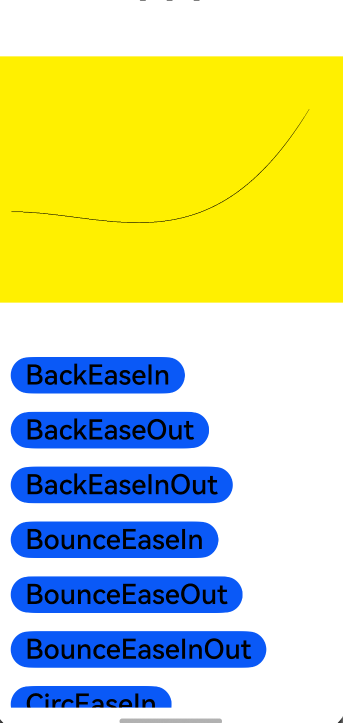

<div align="center">
<h1>easingfunctions4cj</h1>
</div>

<p align="center">


</p>

## 介绍

easingfunctions4cj是一个动画效果库，该库的函数曲线可用于控制动画对象实现特定的运动轨迹。

### 特性

1. 支持多种动画效果

### 源码目录

```shell
├─AppScope
├─doc        # API文档和使用手册存放目录                   
├─entry      # 示例代码文件夹    
├─hvigor  # 构建工具目录              
├─easingfunctions    # easingfunctions4cj 库文件夹                   
│  └─src
│      └─main
│          ├─cangjie
│          │  └─src           # 框架代码目录
│          └─resources
├─README.md  # easingfunctions4cj 介绍及使用说明
```

- `AppScope` 全局资源存放目录和应用全局信息配置目录
- `doc` API文档和使用手册存放目录
- `entry` 工程模块 - 编译生成一个HAP
- `entry src` APP代码目录
- `entry src main` APP项目目录
- `entry src main cangjie` 仓颉代码目录
- `entry src main resources` 资源文件目录
- `easingfunctions` 工程模块 - 编译生成一个har包
- `easingfunctions src` 模块代码目录
- `easingfunctions src main` 模块项目目录
- `easingfunctions src main cangjie` 仓颉代码目录
- `easingfunctions src main resources` 资源文件目录
- `easingfunctions src main cangjie src` 仓颉源码文件目录
- `hvigor` 构建工具目录

### 接口说明

主要类和函数接口说明详见 [API](doc/feature_api.md)

## 使用说明

### 编译构建

1. 通过module引入
    1. 克隆下载项目
    2. 将easingfunctions模块拷贝到应用项目下
    3. 修改自身应用 entry 下的 oh-package.json5 文件，在 dependencies 字段添加 "easingfunctions": "file:../easingfunctions"
       ```json
       {
          "name": "entry",
          "version": "1.0.0",
          "description": "Please describe the basic information.",
          "main": "",
          "author": "",
          "license": "",
         "dependencies": {
             "seasingfunctions": "file:../easingfunctions"
         }
       }
       ```
    4. 修改自身应用 entry/src/main/cangjie 下的 cjpm.toml 文件，在 [dependencies] 字段下添加 easingfunctions = {path = "../../../../easingfunctions/src/main/cangjie", version = "1.0.0"}
       ```toml
       [dependencies]
           easingfunctions4cj = {path = "../../../../easingfunctions4cj/src/main/cangjie", version = "1.0.0"}
       ```
    5. 在项目中使用 import easingfunctions.* 引用easingfunctions项目
       ```cangjie
       import easingfunctions.*
       ```

2. 把 easingfunctions 作为三方库依赖引入
    1. 目标工程把 easingfunctions 依赖库作为 git submodule 引入

    ```
    > cd $工程根目录
    > mkdir third-party
    > cd third-party
    > git submodule add "https://gitcode.com/Cangjie-TPC/easingfunctions4cj.git"
    ```
    2. 修改自身应用 entry/src/main/cangjie 下的 cjpm.toml 文件，添加依赖
    ```toml
    [dependencies]
        easingfunctions4cj = {path = "../../../../third-party/easingfunctions4cj/easingfunctions/src/main/cangjie", version = "1.0.0"}
     ```
    3. 在项目中使用 easingfunctions 组件
       ```cangjie
       import easingfunctions.*
       ```

### 功能示例

```cangjie
//第一步：创建自己需要的动画
var animator: AnimatorResult = AnimatorResult(
    AnimatorOptions(
        duration: 1000,
        easing: "linear",
        delay: 0,
        fill: AnimatorFill.None,
        direction: AnimatorDirection.Normal,
        iterations: 1,
        begin: 0.0,
        end: 1.0
    )
)

//第二步，实现onframe方法，并调用函数方法进行计算
this.animator.onframe = {
    value: Float64 =>
    var xDistance = this.endPoint.x - this.beginPoint.x;
    var yDistance = this.endPoint.y - this.beginPoint.y;
    this.lineToParams.x = this.beginPoint.x + value * xDistance
    var f: Float64 = value;
    var f2: Float64 = skill.getMethod().calculate(value, 0.0, 120.0, 1.0);
    this.lineToParams.y = 170.0 - f2
    Hilog.info(0x0000, "v1", "liney = ${this.lineToParams.y}")
    this.onAnimateUpdate();
}
```

<p align="left">

</p>

## 约束与限制

在下述版本验证通过：

    DevEco Studio NEXT Developer Beta2(5.0.3.900) 
    Cangjie Support Plugin 5.0.3.900

## 开源协议

本项目基于 [MIT License](./LICENSE) ，请自由的享受和参与开源。

## 参与贡献

欢迎给我们提交PR，欢迎给我们提交Issue，欢迎参与任何形式的贡献。